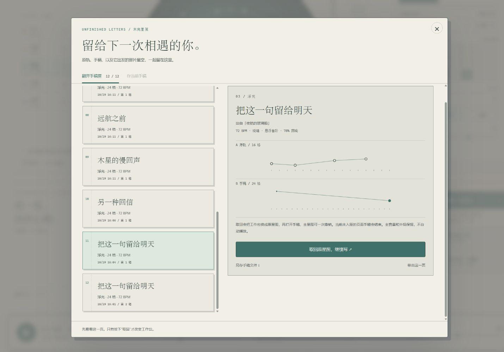

# 星轨留声机 · STARGRAM

**点亮星星，让轨道替你作曲。**

[**在线游玩 →**](https://17timg-bit.github.io/stargram/) · [GitHub 仓库](https://github.com/17timg-bit/stargram)

这是一个可以离线玩的星空音乐玩具。五颗彗星沿着五条轨道运行，每当它们与一颗星星相遇，就会奏出一个音符。改变一圈的长度，同样的音符便会不断遇到不同的伙伴。



当前版本是 **v1.11「未完星笺」**，在线与离线入口使用相同的完整应用。无需登录，打开上方网址即可游玩、保存手稿和分享自己的作品；也可双击根目录的`打开星轨留声机.html`离线使用。

## 打开就能玩

直接访问 **[在线版](https://17timg-bit.github.io/stargram/)**，再点击左下角播放按钮即可，无需登录 GitHub。声音、作品和收藏都在自己的浏览器中处理。

离线游玩则下载并双击项目根目录的 **`打开星轨留声机.html`**。

无需安装、无需服务器、无需账号、无需联网。完整应用就在这一个 HTML 文件里，可以单独复制到其他文件夹或电脑。推荐使用支持 Web Audio 的现代桌面浏览器；v1.11实际验收使用 Windows 上的应用内浏览器，历史版本也在 Tabbit / Chromium 验收。小屏幕排版经过浏览器尺寸模拟，未在实体手机上验收。

第一次先听听「晨雾中的信号」，然后试着把右侧「浮光」的一圈从 16 格改成 12 格。

## v1.11「未完星笺」：写到一半，留给明天

在织星台点 **存一页手稿**，给它取个名字，稿面与原星图会一起收入最多12页的手稿匣。刷新、关闭或换一张星图后，都能从主界面的 **未完星笺 · 手稿匣** 再翻开。

- **先看看，再取回**：预览原轨与手稿各自的一圈、来源星图、速度和调性。只有点“取回原星图，继续写”才替换工作台，再打开独立手稿；主星图可以一次撤销，主音量、外观和收藏保留，不自动播放。
- **更新，或分出另一页**：取回后的修改可保存修订，也可另存一页。相同名字与内容不重复占位置；放满或写入失败时不挤掉旧稿，移出也可以撤销。
- **把未完的念头带走**：可以另存单页手稿JSON，原轨、稿面和原星图都在文件里。读入文件先预览，确认收入匣中后再取回，适合在不同浏览器或电脑间继续写。

这是明确保存的快照。新的修改记得再保存；选区、旧撤回历史和试听不入匣，种回作品也不会自动改掉已保存的手稿。普通星图JSON和手稿JSON用途不同，手稿文件在匣中读入。

`示例作品/v1.11.0/`附有两份真实导出的手稿，以及取回、应用后导出的续写样片。设计取舍见`docs/v1.11未完星笺.md`，技术范围见`验证记录/v1.11.0/验收报告.md`。

## v1.10「星句剪影」：让这一句，换个方向

在织星台点谱纸上方的两个格号，圈出一句旋律。整列光带与星点轮廓会显示这次操作的范围；也可以圈选整轨，或取消圈选。

- **升降与倒影**：按当前音阶整句升降、反转音序，或在片段的高低音之间做倒影。越出音域会整次停住。
- **错开与回应**：把选区内部的节奏提前或推后一格；后方有足够留白时，接上一句完整的副本，保留留白和力度。
- **每一步都能回来**：变换只改手稿，一次撤回整个片段；原轨仍在旁边，可以A/B试听，满意后再种回星图。

键盘聚焦音格后，按住`Shift`配合左右方向键、`Home`或`End`圈选；`Ctrl/Cmd+A`在谱纸内圈选整轨。选择不会改音或打断试听；改变周期会清除旧选区。尚未入匣的手稿是本次页面暂存，刷新前请先应用或存入手稿匣。

`示例作品/v1.10.0/`附有从真实界面手写、反转、升音和接句得到的「星句剪影_本地样片」，包含JSON、WAV、MIDI、PNG与SL1信笺码。设计取舍与八种操作的精确规则见`docs/v1.10星句剪影.md`，技术验证见`验证记录/v1.10.0/验收报告.md`。

## v1.9「漫游星图」：让下一站，换一种心跳

“偶遇一片新星空”现在会生成整张新作品：引力、余温也有新的音高、节奏、星数、周期与相位，时间流速、调性和回响一起参与生成。你的**主音量与外观保持原样**，五条声部重新启用并得到与密度相配的分轨音量。

生成器在晨光信号、潮汐回航、玻璃漂流、近日巡游、月背电台和彗尾慢行六种音乐气质之间探索。声部围绕共同短动机展开，以不同的留白、音区、周期和回应方式相遇。演奏中按“偶遇”会从新曲起点继续，暂停时生成后保持暂停；一次撤销就能回到上一张星图。

各次生成可能碰巧使用相同音阶或回响，整首编排会重新生成；速度在当前值之外重新选取。1000个固定种子实测覆盖80种BPM、3种音阶、67种回响，原先固定的引力出现991种完整轨道结果，余温1000种。多样性不等于每首都同样好听，喜欢的一站仍可手写续改或收藏。

`示例作品/v1.9.0/`提供玻璃漂流（66 BPM）、近日巡游（108 BPM）和潮汐回航（72 BPM）三组JSON、真实导出的WAV与MIDI，便于对比。这些是生成器的8小节样片，不是完整制作的乐曲。生成方法与验证边界见 `docs/v1.9漫游星图.md`、`验证记录/v1.9.0/验收报告.md`。

## v1.8「星际来信」：把自己的这一圈，寄给某个人

打开“带走这片星空”，选择 **寄出当前星图**。五条轨道的音符、轻重、混音和外观配方会被装进一张带邮票的信笺。网页生成游玩链接，离线入口生成可复制的 **SL1信笺码**；点击“先拆开看看”就能在本机试读。

对方打开后先看到预览，自己的工作台保持原样。点“放到我的唱片机”才接收，可一次撤销；可以选择是否也采用随信外观，收藏仍在原来的书架。声音等点击播放才开始。修改粘贴内容会立即废弃旧预览，不会接收错信。

信笺保存的是生成时的版本，以后修改作品不会改变已复制的信。无需账号、后台或上传作品；也没有代替你发送消息。作品数据可读，并非加密，外观与音乐完整保留。对方需要 **v1.8或更新版**。本地地址只能在自己电脑上预览；在公开网页生成的链接可以寄给朋友。

`示例作品/v1.8.0/穿过玫瑰星云的信.txt` 是一封340字符的演示信，可粘贴到 **读一封来信 → 展开来信**。同目录JSON与MIDI是实际导出文件。项目分析、后续方向与协议说明见 `docs/v1.8星际来信.md`，技术边界见 `验证记录/v1.8.0/验收报告.md`。

## v1.7「回声手稿」：从这一圈，写向下一圈

织星台现在先抄下你选中的轨道，把它铺成一张可以动手写的 **星谱纸**。横向是这一圈实际听到的格子，纵向是十个音高；原轨位置留下空心标记，手稿上的星星是实心。点空格写音，点同一个音删除，点同列的其他音改变音高。

- **手写一圈**：改音高、轻重、周期或错开一格；手稿有自己的撤回、重做、抄回原轨与留白操作。原作品会等你按下“把手稿种回这条轨道”才改变，应用仍可在主界面一次撤销。
- **A/B 比较**：A 听原轨，B 听手稿，各自按自己的周期走完一圈与余音。两边共用当前音色、音量和回响；试听不会落下主唱针。
- **明确地寻找新旋律**：展开“织一个新念头”，选择疏密、走向、音区与呼吸，再按“织出候选”。仅仅调整这些选项不会覆盖手写内容，生成后也可撤回。
- **暂时放下，再接着写**：关窗后，在本次页面里重新打开同一条未改变的轨道，就能接回手稿和编辑历史。这是页面暂存，刷新或换整张星图会结束暂存；要保存到作品，请先种回轨道。

键盘聚焦星谱纸后，用方向键移动，`Enter` / `Space` 写音；`Home` / `End` 到首尾格，`Ctrl+Z` / `Ctrl+Shift+Z` 撤回与重做手稿。长周期在星谱纸内部横向滚动，窄屏也能写到最后一格。

本版没有改变星图、收藏和外观配方的格式。`示例作品/v1.7.0/` 附带从真实界面改写并导出的「回声手稿_本地样片」JSON、WAV、MIDI 与封面。设计说明见 `docs/v1.7回声手稿.md`，验证范围见 `验证记录/v1.7.0/验收报告.md`。

## v1.6「宇宙暗房」：组合属于你的宇宙

右上角打开 **宇宙暗房**，把四层材料自由混搭。六种天幕不只有底色，还有尘云、星芒、月面坑缘或极光帷幕；五种光谱染上唱片、金属和控件；四种星盘纹样与三种标题字样再为它留下性格，共 **360 种组合**。

- **天幕**：黄道晨光、月海银尘、银河远岸、玫瑰星云、昴宿蓝雾、极光帷幕。
- **光谱**：氢红、氧青、钠金、星蓝、日珥橘。
- **星盘**：土星环纹、航海星图、衍射星芒、月面拓印。
- **字样**：星图书页、空间站讯号、观测手记。

左边的样片即时使用你当前的星图。可以逐步试搭、退一步、回到进入暗房时的样子，或者“偶遇一束光”。也有六份完整的起始配方，包含三套熟悉的旧外观。

喜欢的搭配有一个 **观测配方编号**，例如 `SG1-4423`。复制给朋友，再在暗房的“读入配方”中输入，就能复现外观；PNG 封面下方也会印上编号。外观会自动记住，旧主题偏好自动读取，乐曲与收藏保持独立。

天文意象经艺术演绎，全部纹理由程序绘制，仍然完全离线。设计与资料依据见 `docs/v1.6宇宙暗房.md`。

## v1.5「光影之间」：给声音换一束光

右上角点 **“换装”**，在三间唱片室之间选择：暖白与墨绿的 **纸间晴昼**、墨色与黄铜的 **鎏金夜航**、雾蓝与银色的 **雾蓝回声**。界面、唱片、织星谱、收藏缩略图和 PNG 封面一起换装；预设封套保留自己的配色。主题在此浏览器单独记住，切换不改动音乐或收藏，也可以边听边比较。

唱臂有了停靠座：暂停时抬到唱片外，播放时平滑落入圆盘，停止后回座。开启“减少动画”时直接切换到位；织星候选的独立试听不会落下主唱针。

修复了短窗口左下角说明、快捷键和星数叠在一起的问题；它们现在共同排版，手机声部条与底部说明各有位置。底座的“星图调性”控制音阶，外观由右上角独立选择。详情见 `docs/v1.5光影细节.md`。

## v1.4「星际唱片室」：一张正在演奏的唱片

从夜间观测台走进一间明亮的独立唱片室。暖白纸面、墨绿唱片、薄荷和朱橙色重新组织了整个界面。

- **大唱片成为主角**：星轨留在墨绿胶片里，添上细密唱纹、纸质圆标和唱臂。五个声部在唱片旁选择，手机上移到下方。
- **重新排版的工作室**：大字号开场、两栏演奏/调音布局、底部唱片箱，以及常驻演奏底座。右侧保存状态独立固定，长轨道设置可以滚动。
- **三张彩色唱片封套**：日轮、潮汐、晶面三幅 SVG 原创插画，配编号与侧标；也可以展开观测手记，保留自己的探索进度。
- **完整的一套纸面窗口**：书架改为唱片陈列；玩法、命名、织星台和导出柜台一起重做。织星台明确标注“新候选”，延续 v1.3 的生成行为。
- **新的明信片封面**：导出柜台增加 PNG 入口，和舞台的“拍张照”使用同一份 1600×1200 图。普通与沉浸视图使用独立一致的导出构图。

音乐、星图 v2、旧版 v1 导入和书架沿用原规则。颜色和布局变化不会迁移、清空或重建作品。详情见 `docs/v1.4美术记录.md` 和 `验证记录/v1.4.0/验收报告.md`。

## v1.3「织星台」：先织一个念头

以下记录 v1.3 初版的生成式织星台。v1.7 已把生成器保留在“织一个新念头”中，并增加从原轨起笔的手稿编辑与 A/B 比较。

点击右侧轨道名称旁的 **「✧ 织星台」**。选一圈的长度、几颗星、旋律走向和音区，在暖纸色的环形谱上查看草稿，然后试听。喜欢时再种进轨道。

- **调整疏密**：1 到满格的星星均匀散开；8 / 12 / 16 / 20 / 24 格周期可在草稿里直接尝试。
- **四种走向**：回旋、升起、落下和漫游。可以再织一次，也可以把旋律错开一格。
- **轻重呼吸**：第一颗更亮，最后一颗轻轻落下；也可以关闭轻重变化。文字音符序列与环形谱同时显示草稿。
- **先听再决定**：只试听当前草稿轨道，使用现有音色、分轨音量、总音量和回响；试听暂时绕过静音与独奏。主星图暂停，试听走完一圈和余音后自动停止；修改参数、关闭窗口或手动停止都会取消旧试听。
- **保留自己的选择**：关闭不改原星图；应用只替换当前轨道的旋律、周期和相位，保留音量、静音与独奏。一次撤销就能回到应用前。

试试「浮光 → 12 格 → 7 颗 → 漫游」。不必寻找标准答案，留下你喜欢的那一圈就好。

`示例作品/v1.3.0/` 放了用织星模型制作的「花园之外，还有星星」星图，以及从实际应用导出的 WAV 和 MIDI。它使用五个不同周期，可以导入继续改写。制作与技术边界见 `docs/v1.3制作记录.md`。

## v1.2「夜色观测室」的样子

- **一本会演奏的星图册**：墨绿、薄荷、黄铜和暖纸色，搭配宋体标题、细线、编号与轻微颗粒。
- **三张小唱片封面**：晨雾的日轮、潮汐的波线、玻璃船的晶面，都由内嵌 SVG 绘制。
- **五枚乐器按键**：五轨并排，选中、静音与独奏有各自的反馈；调音区保留清楚的分组。
- **观测仪器般的星空**：金属感轨道、分段黄铜刻度、中心罗盘与柔和星云；明信片也采用同一套边框和排版。
- **纸签收藏卡**：深色星图下方是温暖的纸质标签；窄屏封面、书架弹窗与演奏区分别适配。

乐曲规则、存档键与 v2 星图格式沿用 v1.1。没有新增下载依赖，仍可单文件离线运行。制作与验收见 `docs/v1.2美术记录.md` 和 `验证记录/v1.2.0/验收报告.md`。

## v1.1「星图书架」的功能

- **作品命名与书架**：点标题旁的小笔命名，收藏最多 24 张独立星图快照。打开旧收藏继续编辑，原收藏保持不变；移除后可以撤销。书架只保存在此浏览器，喜欢的作品仍建议导出 JSON。
- **调音模式与轻重音**：右侧切到「调音」，点一颗已有星星，再改音高或点「轻 / 中 / 重」。它会立即试听，星芒也会跟着改变。种星模式下的力度按钮决定下一颗新星的力度；Shift+点击已有星星可快速切换。
- **每条轨道的混音**：分别调节音量，或点「独奏」只听一条，也可同时独奏几条。现场声音、WAV 与 MIDI 都遵守相同的选择。
- **重做**：撤销后可以重做；新的编辑会开启一条新的修改路径。历史保留最近 60 次。
- **沉浸视图**：右上角「沉浸」收起两侧工作台，留下星空与演奏控制。按 Esc 或「返回工作台」回来。
- **更清楚的演奏反馈**：当前小节和节拍跟随音频时钟，轨道相遇时显示名字；三种音阶各有轻微的星云色彩。

## 怎么玩

| 操作 | 发生什么 |
| --- | --- |
| 点击轨道上的空位 | 种下一颗星星 |
| 点击已有星星 | 删除这颗星星 |
| 拖动星星 | 改变出现时机；跨轨道改变音色；目标已有星星时交换位置 |
| 右击星星或右侧已亮格子 | 音高升一级，最高后回到最低 |
| 右侧「新星的音高」 | 设置接下来添加的音符；不会改动已有星星 |
| 「调音」后选中星星 | 右侧音高和轻重按钮直接调整这颗星星 |
| Shift+点击已有星星 | 依次切换轻、中、重音 |
| 改变一圈长度 | 把原有音符按相对位置映射到新周期；缩短时相邻音符可能合并，可撤销 |
| 旋转一格 | 整条轨道推迟半拍发声 |
| 点击音轨旁的小圆点 | 单独静音 / 恢复 |
| 右侧「独奏」与分轨音量 | 调整当前轨道；独奏可以叠加，静音优先 |
| 偶遇一片新星空 | 重新生成五轨、速度、音阶和回响，保留主音量与外观，可撤销 |
| 时间流速 / 回响 / 音量 | 调节速度、空间感和总体音量 |

键盘：`Space` 播放 / 暂停，`Ctrl+Z` 撤销，`Ctrl+Shift+Z` / `Ctrl+Y` 重做，`1–5` 选择轨道，`?` 打开玩法，`Esc` 退出沉浸。按钮聚焦时，空格执行该按钮的标准键盘动作。所有星星也都能用右侧格子按钮和键盘操作。

五种声音分别是「引力」低音、「余温」柔和泛音、「浮光」拨弦、「冰晶」钟音、「远星」轻盈长音。音色通过振荡器和包络在本机合成，不使用歌曲采样或外部音源。

## 留下自己的作品

- **自动存档**：修改后保存在当前浏览器。本地文件的存档空间可能随浏览器或文件路径改变；清除浏览数据也会丢失，所以喜欢的作品请另存星图文件。
- **星图 JSON**：新版导出 v2，保留音符、力度、音阶、速度、周期、旋转、独奏、静音、分轨音量和混响。兼容导入 v1 旧星图，原音符与电平保持一致；v2 星图需要 v1.1 或更高版本，v1.0 会拒绝它。导入前会校验格式，导入后可以撤销。
- **WAV**：从第一个节拍开始合成 **8 小节（64 个半拍格）**，另加 3.2 秒尾音；44.1 kHz / 16-bit / 双声道。不是麦克风录音，也不包含即时操作过程。
- **MIDI**：同样导出 8 小节，含五条独立音轨和速度轨。静音轨不输出音符；播放器使用自己的音源，因此不会与应用内音色完全一样。
- **明信片 PNG**：把当前星图保存为 1600 × 1200 的图片。

导出文件保存在浏览器的下载位置。应用的提示表示已经发起下载；若浏览器暂时没有显示文件，请查看它自己的下载状态。所有文件只在本机生成。

切换到其他标签页时，演奏自动暂停。回来后手动播放即可；暂停后从下一格继续，从头按钮会重新对齐所有轨道。

## 随附作品

`示例作品/音乐/` 内有三张初始星图的 WAV 和 MIDI，`示例作品/星图/` 内有可以重新导入的星图文件，`示例作品/明信片/` 内有应用实际导出的图片。

`示例作品/v1.1.0/` 另外放了两张书架演示星图「薄荷色的回声」「玻璃海上的灯塔」，以及「薄荷色的回声」带轻重音的 WAV / MIDI。可从导出面板导入 JSON 试玩；导入不会自动占用书架，喜欢时再收藏。

它们是这件乐器的演示片段，不是另行制作的完整乐曲。不同周期的完整共同循环可能长于 8 小节，因此导出的 WAV 不一定能无缝循环。

## 文件结构

```text
星轨留声机/
├─ index.html              GitHub Pages 网页入口，与离线版本一致
├─ 打开星轨留声机.html       双击入口，独立完整应用
├─ README.md               使用说明
├─ src/                    页面、样式、音乐模型、音频引擎和交互源码
├─ scripts/                构建与产物校验脚本
├─ tests/                  模型测试、浏览器验收脚本和无效导入样本
├─ docs/                   设计说明与开发说明
├─ 示例作品/
│  ├─ 音乐/                三段 WAV 与对应 MIDI
│  ├─ 星图/                三份可导入 JSON
│  └─ 明信片/              1600 × 1200 PNG
└─ 验证记录/               实际截图、检测数据和验收报告
```

## 继续开发

只需要 Node.js 来重新构建；运行成品不需要它。

```powershell
node scripts/build.js
node --test tests/core.test.js tests/v1.1.test.js tests/v1.3.test.js tests/v1.6.test.js tests/v1.7.test.js tests/v1.8.test.js tests/v1.9.test.js tests/v1.10.test.js tests/v1.11.test.js
python scripts/verify_v111.py
```

没有 npm 包、构建框架、CDN、字体下载和后台服务。详见 `docs/开发说明.md`。

## 网页更新

GitHub Pages 从 `main` 分支根目录发布。修改源码后运行 `node scripts/build.js`，会同时生成 `index.html` 与离线入口；提交并推送到 `main` 后，GitHub 自动更新网页。`.nojekyll` 保证按原始静态文件发布。

在线版和本地文件版各自使用浏览器存储，作品不会自动跨地址同步；需要迁移时导出并导入星图 JSON。

2026-10-29 · Version 1.11.0
