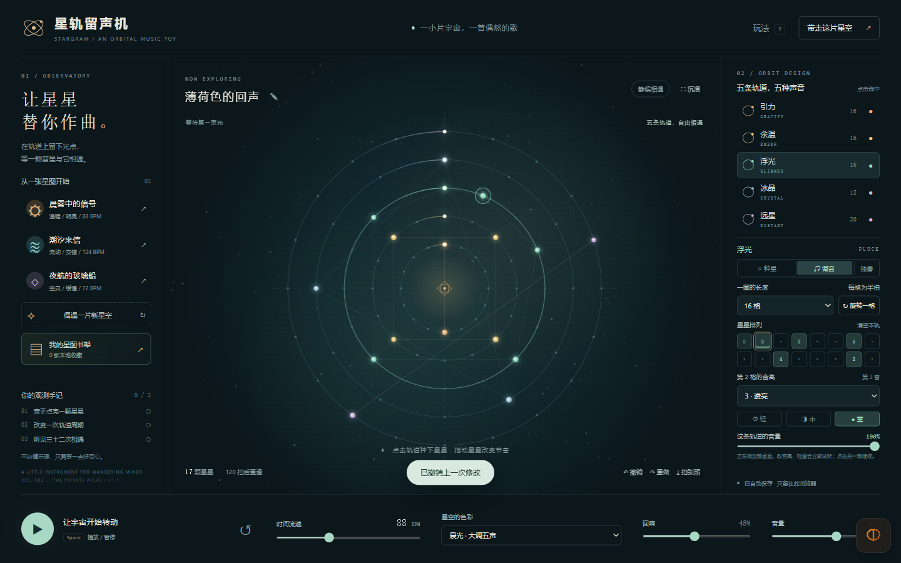

# 星轨留声机 · STARGRAM

**点亮星星，让轨道替你作曲。**

> 当前目录是 **v1.1.0「星图书架」本地预览版**，尚未上传。请双击 `打开星轨留声机.html` 试玩新版。公开网页和 GitHub 仍保持上次发布的版本。

[已发布旧版网页](https://17timg-bit.github.io/stargram/) · [GitHub 仓库](https://github.com/17timg-bit/stargram)

这是一个可以离线玩的星空音乐玩具。五颗彗星沿着五条轨道运行，每当它们与一颗星星相遇，就会奏出一个音符。改变一圈的长度，同样的音符便会不断遇到不同的伙伴。



## 打开就能玩

本次新版请直接双击根目录 **`打开星轨留声机.html`**，再点击左下角播放按钮。无需联网，声音、作品和收藏都在自己的浏览器中处理。

离线游玩则下载并双击项目根目录的 **`打开星轨留声机.html`**。

无需安装、无需服务器、无需账号、无需联网。完整应用就在这一个 HTML 文件里，可以单独复制到其他文件夹或电脑。推荐使用支持 Web Audio 的现代桌面浏览器；本次实际验收使用 Windows 上的 Tabbit / Chromium。小屏幕排版经过浏览器尺寸模拟，未在实体手机上验收。

第一次先听听「晨雾中的信号」，然后试着把右侧「浮光」的一圈从 16 格改成 12 格。

## v1.1「星图书架」的新东西

- **作品命名与书架**：点标题旁的小笔命名，收藏最多 24 张独立星图快照。打开旧收藏继续编辑，原收藏保持不变；移除后可以撤销。书架只保存在此浏览器，喜欢的作品仍建议导出 JSON。
- **调音模式与轻重音**：右侧切到「调音」，点一颗已有星星，再改音高或点「轻 / 中 / 重」。它会立即试听，星芒也会跟着改变。种星模式下的力度按钮决定下一颗新星的力度；Shift+点击已有星星可快速切换。
- **每条轨道的混音**：分别调节音量，或点「独奏」只听一条，也可同时独奏几条。现场声音、WAV 与 MIDI 都遵守相同的选择。
- **重做**：撤销后可以重做；新的编辑会开启一条新的修改路径。历史保留最近 60 次。
- **沉浸视图**：右上角「沉浸」收起两侧工作台，留下星空与演奏控制。按 Esc 或「返回工作台」回来。
- **更清楚的演奏反馈**：当前小节和节拍跟随音频时钟，轨道相遇时显示名字；三种音阶各有轻微的星云色彩。

## 怎么玩

| 操作 | 发生什么 |
| --- | --- |
| 点击轨道上的空位 | 种下一颗星星 |
| 点击已有星星 | 删除这颗星星 |
| 拖动星星 | 改变出现时机；跨轨道改变音色；目标已有星星时交换位置 |
| 右击星星或右侧已亮格子 | 音高升一级，最高后回到最低 |
| 右侧「新星的音高」 | 设置接下来添加的音符；不会改动已有星星 |
| 「调音」后选中星星 | 右侧音高和轻重按钮直接调整这颗星星 |
| Shift+点击已有星星 | 依次切换轻、中、重音 |
| 改变一圈长度 | 把原有音符按相对位置映射到新周期；缩短时相邻音符可能合并，可撤销 |
| 旋转一格 | 整条轨道推迟半拍发声 |
| 点击音轨旁的小圆点 | 单独静音 / 恢复 |
| 右侧「独奏」与分轨音量 | 调整当前轨道；独奏可以叠加，静音优先 |
| 偶遇一片新星空 | 用当前音阶、速度和周期生成一个新编排，可撤销 |
| 时间流速 / 回响 / 音量 | 调节速度、空间感和总体音量 |

键盘：`Space` 播放 / 暂停，`Ctrl+Z` 撤销，`Ctrl+Shift+Z` / `Ctrl+Y` 重做，`1–5` 选择轨道，`?` 打开玩法，`Esc` 退出沉浸。按钮聚焦时，空格执行该按钮的标准键盘动作。所有星星也都能用右侧格子按钮和键盘操作。

五种声音分别是「引力」低音、「余温」柔和泛音、「浮光」拨弦、「冰晶」钟音、「远星」轻盈长音。音色通过振荡器和包络在本机合成，不使用歌曲采样或外部音源。

## 留下自己的作品

- **自动存档**：修改后保存在当前浏览器。本地文件的存档空间可能随浏览器或文件路径改变；清除浏览数据也会丢失，所以喜欢的作品请另存星图文件。
- **星图 JSON**：新版导出 v2，保留音符、力度、音阶、速度、周期、旋转、独奏、静音、分轨音量和混响。兼容导入 v1 旧星图，原音符与电平保持一致；v2 星图需要新版应用，已发布的旧网页会拒绝它。导入前会校验格式，导入后可以撤销。
- **WAV**：从第一个节拍开始合成 **8 小节（64 个半拍格）**，另加 3.2 秒尾音；44.1 kHz / 16-bit / 双声道。不是麦克风录音，也不包含即时操作过程。
- **MIDI**：同样导出 8 小节，含五条独立音轨和速度轨。静音轨不输出音符；播放器使用自己的音源，因此不会与应用内音色完全一样。
- **明信片 PNG**：把当前星图保存为 1600 × 1200 的图片。

导出文件保存在浏览器的下载位置。应用的提示表示已经发起下载；若浏览器暂时没有显示文件，请查看它自己的下载状态。所有文件只在本机生成。

切换到其他标签页时，演奏自动暂停。回来后手动播放即可；暂停后从下一格继续，从头按钮会重新对齐所有轨道。

## 随附作品

`示例作品/音乐/` 内有三张初始星图的 WAV 和 MIDI，`示例作品/星图/` 内有可以重新导入的星图文件，`示例作品/明信片/` 内有应用实际导出的图片。

它们是这件乐器的演示片段，不是另行制作的完整乐曲。不同周期的完整共同循环可能长于 8 小节，因此导出的 WAV 不一定能无缝循环。

## 文件结构

```text
星轨留声机/
├─ index.html              GitHub Pages 网页入口，与离线版本一致
├─ 打开星轨留声机.html       双击入口，独立完整应用
├─ README.md               使用说明
├─ src/                    页面、样式、音乐模型、音频引擎和交互源码
├─ scripts/                构建与产物校验脚本
├─ tests/                  模型测试、浏览器验收脚本和无效导入样本
├─ docs/                   设计说明与开发说明
├─ 示例作品/
│  ├─ 音乐/                三段 WAV 与对应 MIDI
│  ├─ 星图/                三份可导入 JSON
│  └─ 明信片/              1600 × 1200 PNG
└─ 验证记录/               实际截图、检测数据和验收报告
```

## 继续开发

只需要 Node.js 来重新构建；运行成品不需要它。

```powershell
node scripts/build.js
node --test tests/core.test.js
node --test tests/v1.1.test.js
python scripts/verify_artifacts.py
```

没有 npm 包、构建框架、CDN、字体下载和后台服务。详见 `docs/开发说明.md`。

## 网页更新

GitHub Pages 从 `main` 分支根目录发布。修改源码后运行 `node scripts/build.js`，会同时生成 `index.html` 与离线入口；提交并推送到 `main` 后，GitHub 自动更新网页。`.nojekyll` 保证按原始静态文件发布。

在线版和本地文件版各自使用浏览器存储，作品不会自动跨地址同步；需要迁移时导出并导入星图 JSON。

2026-10-27 · Version 1.1.0 / Local preview
